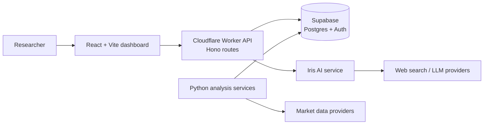

<div align="center">

# CoinVisio

**A crypto market research dashboard combining market data, quantitative signals, anomaly detection, and an AI research assistant.**

An experimental project — not a live financial product.

</div>

<p align="center">
  <a href="docs/architecture.md">Architecture</a> ·
  <a href="docs/project-brief.md">Project overview</a> ·
  <a href="Worker/migration/">API notes</a>
</p>

---

## What it does

CoinVisio brings several crypto market research views into one React application:

- **Market dashboard** with coin prices, charts, and a personal watchlist
- **Signals and recommendations** produced by the analysis pipeline
- **Market regime and anomaly views** to summarize broader conditions and unusual activity
- **Iris**, a conversational research assistant that can use market context and web search
- **Accounts and notifications** for a personalized experience

The project explores how a web interface, an edge API, and a separate Python analysis service can work together. It does not execute trades or provide financial advice. Historical outputs are not evidence of predictive performance.

## Product preview

The repository includes the application source and a concise project overview. It does not currently include a hosted demo or production screenshots; the former service is offline. The architecture diagram below describes the codebase at a high level.



## Architecture

| Part | Role | Main technologies |
| --- | --- | --- |
| `react/` | Dashboard, charts, authentication, and feature pages | React, Vite, Tailwind CSS, Recharts |
| `Worker/` | HTTP API, validation, authentication, rate limiting, and scheduled jobs | Cloudflare Workers, Hono, Durable Objects |
| `CoinVisioBrain/` | Market data ingestion and analysis services | Python, pandas, scikit-learn, Supabase |
| `db/` | Database schemas and migration SQL | PostgreSQL / Supabase |

The Python code includes signal generation, market regime classification, anomaly detection, recommendations, and AI-assisted insights. The Worker migration notes document the move from an earlier ASP.NET Core API toward a single edge API.

See [the architecture notes](docs/architecture.md) for the request and data flows.

## Run locally

The app depends on external services and credentials. No credentials are included in the setup examples; create your own development keys and use test projects.

### Frontend

```powershell
cd react
Copy-Item .env.example .env.local
npm install
npm run dev
```

Set the frontend variables in `react/.env.local` before using service-backed pages.

### API Worker

```powershell
cd Worker
Copy-Item .dev.vars.example .dev.vars
npm install
npx wrangler dev
```

Use `.dev.vars` for local secrets. Configure production credentials as Cloudflare secrets and bindings; do not put secret values in `wrangler.toml`.

### Python analysis services

```powershell
cd CoinVisioBrain
Copy-Item .env.example .env
python -m venv .venv
.\.venv\Scripts\Activate.ps1
pip install -r requirements.txt
```

The Python services need a Supabase project and, for selected features, model or search provider credentials. Check the individual service requirements before starting a worker.

## Configuration

Use the checked-in examples as variable-name references only:

- `react/.env.example`
- `Worker/.dev.vars.example`
- `CoinVisioBrain/.env.example`

Never commit `.env`, `.dev.vars`, service account files, or real API keys. Public browser configuration still needs to be restricted with provider-side domain limits and database row-level security.

## Project status

CoinVisio was built as an experimental product and is not currently deployed. Provider accounts, data pipelines, and API endpoints may no longer be active. Local setup may require adapting configuration to current provider APIs and database schemas.

## Financial risk

This project is for software demonstration and research. It is not investment advice, and its signals or model outputs should not be used to make financial decisions.
