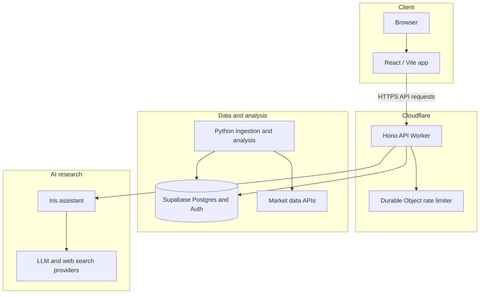

# CoinVisio architecture

CoinVisio separates the user interface, request API, and scheduled market analysis into distinct parts. Supabase provides shared persistence and authentication.

## Responsibilities

- **React application:** dashboard, coin pages, charts, watchlist, signals, anomalies, recommendations, notifications, and account flows.
- **Cloudflare Worker:** API routes, input validation, authentication middleware, CORS policy, rate limiting, and scheduled work.
- **Python services:** market data ingestion and analysis that writes derived data for the application.
- **Supabase:** shared PostgreSQL storage and authentication integration.
- **Iris:** AI-assisted research that combines selected application context with external model and search services.

The repository also contains migration notes for an earlier ASP.NET Core API. The current API implementation is under `Worker/`.

## Data flow

1. The Python pipeline fetches market data and stores it in Supabase.
2. Analysis services derive market summaries, anomalies, signals, recommendations, and insights.
3. The React application requests views through the Worker API.
4. The Worker validates requests and reads the relevant records from Supabase. Iris requests are routed through the assistant service.

This describes the intended integration in the source tree. The project is not deployed, and service availability or end-to-end operation has not been verified.
