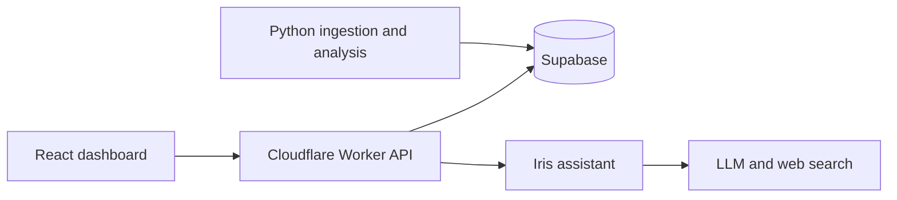

# CoinVisio

### Crypto market research dashboard

An experimental product concept for bringing market context, quantitative analysis, and AI-assisted research into one interface.

**Status:** experimental build · not currently deployed

---

# One interface for market research

CoinVisio combines a dashboard with focused views for:

- Coin prices, charts, and a personal watchlist
- Market regime, anomalies, signals, and recommendations
- Iris, an assistant for questions grounded in application data and external research

The product demonstrates a research workflow. It does not place trades or establish predictive performance.

---

# Three cooperating layers

The UI handles exploration, the Worker provides the application API, and Python services prepare analysis results for shared storage.

**Stack:** React · Cloudflare Workers · Python · Supabase

---

# Engineering focus

- Split interactive API traffic from scheduled data analysis.
- Add request validation, authentication middleware, and rate limiting at the API layer.
- Combine conventional market analysis with an LLM-based research assistant.
- Keep the project honest about its limits: inactive deployment, external-service dependencies, and no verified trading performance.

**Repository:** [github.com/mo-tunn/coinvisio](https://github.com/mo-tunn/coinvisio)
